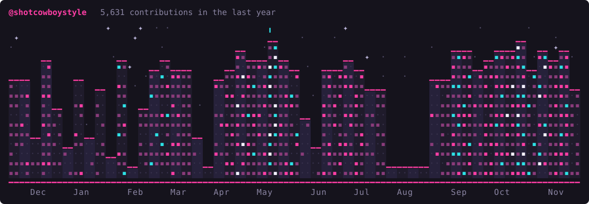

# Curtis Blanton - Full-Stack Creative Developer

Based in Charleston, SC, I craft meticulously designed digital products that combine modern web experiences, reliable automation, and measurable business outcomes. I switch seamlessly between Enterprise IaC architecture, AI-assisted delivery, and pixel-perfect UI while keeping accessibility, performance, and governance front and center.

[Website](https://shotcowboystyle.github.io) · [Experiments](https://shotcowboystyle.github.io/experiments/) · [Toolstack](#toolstack-snapshot) · [Contact](https://shotcowboystyle.github.io/#contact) 

## What I Do

- Build and scale modern web apps with Astro, TypeScript, and consent-ready analytics stacks.
- Engineer enterprise platforms that blend administrative experience (AX), compliance automation, and core systems integrations with measurable observability.
- Automate workflows end-to-end with n8n, AI agents, and custom integrations that eliminate manual toil.
- Translate strategy into execution as a product-minded engineer from prototype to production handoff.

## Toolstack Snapshot

| Area                                | Stack                                                                                                                                                                                                                                                                                                                                                                                                                                                                                                                                                                                                                                                                                                                                                                                                                                                                                                                                                                                                                                                                                                                                                                                                                                                                  |
| ----------------------------------- | ---------------------------------------------------------------------------------------------------------------------------------------------------------------------------------------------------------------------------------------------------------------------------------------------------------------------------------------------------------------------------------------------------------------------------------------------------------------------------------------------------------------------------------------------------------------------------------------------------------------------------------------------------------------------------------------------------------------------------------------------------------------------------------------------------------------------------------------------------------------------------------------------------------------------------------------------------------------------------------------------------------------------------------------------------------------------------------------------------------------------------------------------------------------------------------------------------------------------------------------------------------------------- |
| **Workstation Essentials**          |                                                                                                                                                          |
| **Data &amp; Analytics**            |                                                                                                                                                                                                                                                                                                                                                                                                                                                                                                                                                                         |
| **Automation &amp; Intelligence**   |                     |
| **Low-Code Platforms**              |                                                                                                                                                                                                                                                                                                                                                                                                                                                                                                                                                                                                                                                                                                                                                                                                                                                                                                                                                                                                                                            |
| **Operations &amp; Observability**  |            |
| **Collaboration &amp; Experiencew** |                                                                                                                                                                                                                                                                                                 |

